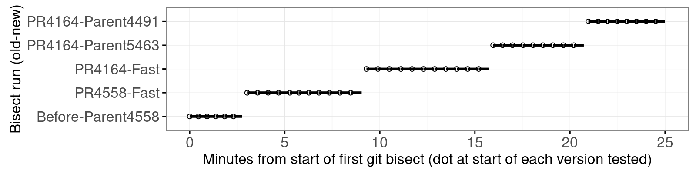
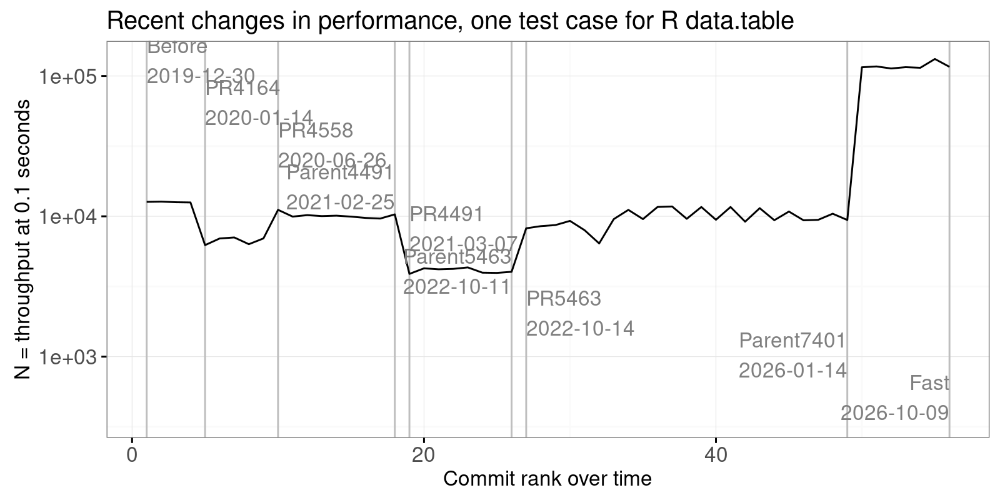

Code for computing bisect data in [[https://github.com/Rdatatable/data.table/pull/7912][PR7912]].

- First run =atime::bisect()=
- Then run [[file:refs.R]] to copy data from data.table/.ci/atime/bisect to this repo.
- Then run [[file:viz.R]] to create interactive figure and

** Figures for asymptotic performance testing submission, SEIP’27

[[file:figure-versions-data.R]] makes [[file:figure-versions-data.rds]]

[[file:figure-versions.R]] makes

[[file:figure-versions-DT_by__fixed_in__4558.png]]

[[file:figure-versions-fread_N_cols_regression.png]]

[[file:computers.R]] makes

[[file:computers-PR7912-minutes.png]]

[[file:computers-PR7912-timeline.png]]

[[file:computers-PR7912-timeline-compare.png]]

[[file:figure-story.R]] makes

[[file:figure-story-PR7912.png]]
